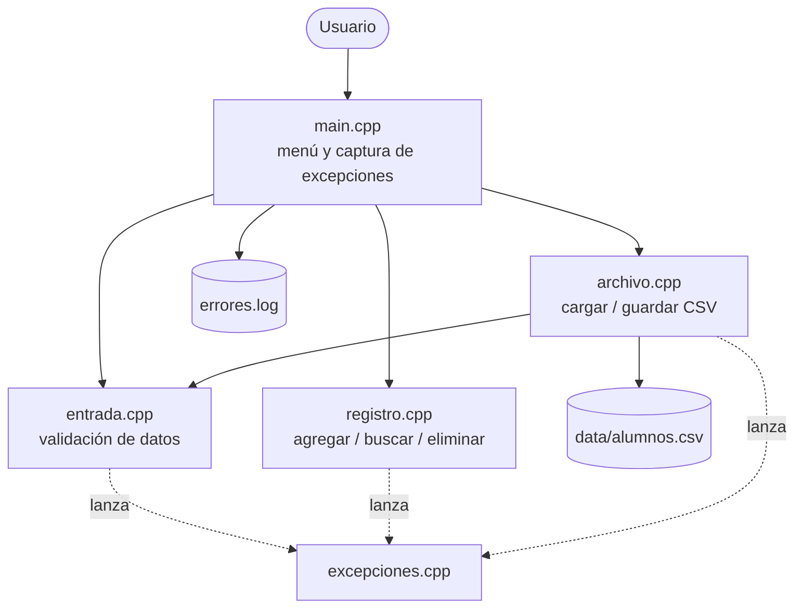
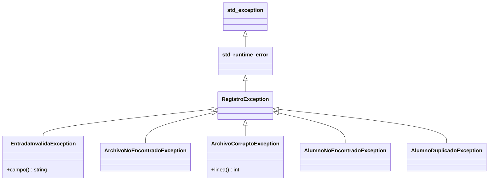

# Práctica 02 · Manejo de Errores y Excepciones en C++

> **Grupo 1** · Universidad Nacional de San Agustín de Arequipa · Escuela Profesional de Ingeniería de Sistemas · 2026

| | |
|---|---|
| **Curso** | Tecnología de Objetos |
| **Docente** | Mg. Maribel Molina Barriga |
| **Lenguaje** | C++17 |
| **Entregables** | Práctica 1 (División segura) · Simulación de sistema (todos los grupos) · Informe APA |

---

## Contenido
1. [Actividades asignadas](#actividades-asignadas)
2. [Reparto del trabajo](#reparto-del-trabajo)
3. [Estructura del repositorio](#estructura-del-repositorio)
4. [Compilar y ejecutar](#compilar-y-ejecutar)
5. [Diseño de la simulación](#diseño-de-la-simulación)
6. [Manejo de errores en C++](#manejo-de-errores-en-c)
7. [Flujo de trabajo en Git](#flujo-de-trabajo-en-git)
8. [Entrega](#entrega)

---

## Actividades asignadas

### Práctica 1 · División segura
**Objetivo:** evitar que el programa se detenga por división por cero.
- Pedir dos números al usuario.
- Manejar el error de división por cero mostrando un mensaje adecuado.
- Mostrar un mensaje de cierre (equivalente a `finally`).

### Todos los grupos · Simulación de sistema: *Registro de alumnos*
**Objetivo:** integrar el manejo de errores en un mini sistema.
- Errores de entrada de datos.
- Archivo no encontrado o corrupto.
- Excepciones personalizadas (`AlumnoNoEncontradoException`, entre otras).
- Documentación de los errores que puede generar el sistema y cómo se manejan → [`docs/errores.md`](docs/errores.md).

## Reparto del trabajo

| Integrante | Parte | Archivos | Rama |
|------------|-------|----------|------|
| **Elkin** | Práctica 1: División segura | `practica1-division-segura/division_segura.cpp` | `feature/practica1` |
| **Fernando** | Validación de entrada de datos | `simulacion-registro-alumnos/src/entrada.cpp` | `feature/entrada` |
| **Diego** | Lectura y escritura de archivo (no encontrado / corrupto) | `simulacion-registro-alumnos/src/archivo.cpp` | `feature/archivo` |
| **Gabriel** | Excepciones personalizadas y lógica del registro | `simulacion-registro-alumnos/src/excepciones.cpp`, `src/registro.cpp` | `feature/excepciones` |
| **Jerry** | Integración (menú, log de errores), documentación e informe | `simulacion-registro-alumnos/src/main.cpp`, `docs/`, `informe/` | `main` |

Cada archivo tiene un bloque `TODO` con las indicaciones exactas. **No modifiquen los `.h` de `include/`**: son el contrato entre las partes. Si necesitan cambiar uno, avisen al grupo primero.

### Checklist por integrante
- [x] **Elkin:** `dividir()` lanza `std::domain_error` si el divisor es 0 · `try/catch` con mensaje claro · mensaje de cierre siempre (RAII) · *(extra)* validar que el dato sea número.
- [x] **Fernando:** `leerLinea` (EOF) · `convertirEntero` (`std::invalid_argument`, `std::out_of_range`, rango) · `convertirNota` (0–20) · `validarCodigo` (8 dígitos) · `validarNombre`.
- [x] **Diego:** `cargarAlumnos` lanza `ArchivoNoEncontradoException` y `ArchivoCorruptoException` (con número de línea) · `guardarAlumnos` lanza `RegistroException` si no puede escribir.
- [x] **Gabriel:** mensajes de las 6 excepciones · `agregar` (duplicado) · `buscar` y `eliminar` (no encontrado).
- [x] **Todos:** verificar que la salida de su parte coincida con el **resultado esperado** de [`docs/pruebas.md`](docs/pruebas.md). No hace falta tomar capturas: ya están en el informe.

## Estructura del repositorio

```
prac02-manejo-errores-cpp/
├── practica1-division-segura/
│   └── division_segura.cpp        Práctica 1 (Elkin)
├── simulacion-registro-alumnos/
│   ├── include/                   Interfaces (contrato entre módulos)
│   │   ├── alumno.h
│   │   ├── excepciones.h
│   │   ├── entrada.h
│   │   ├── archivo.h
│   │   └── registro.h
│   ├── src/
│   │   ├── main.cpp               Menú e integración (Jerry)
│   │   ├── entrada.cpp            Validaciones (Fernando)
│   │   ├── archivo.cpp            Persistencia (Diego)
│   │   ├── excepciones.cpp        Excepciones personalizadas (Gabriel)
│   │   └── registro.cpp           Lógica del registro (Gabriel)
│   └── data/
│       ├── alumnos.csv            Datos de ejemplo
│       └── alumnos_corrupto.csv   Archivo dañado para pruebas
├── docs/
│   ├── errores.md                 Catálogo de errores y su manejo
│   └── pruebas.md                 Casos de prueba
├── informe/                       Informe en formato APA (.docx)
└── Makefile
```

## Compilar y ejecutar

Requisito: compilador con C++17 (`g++` de MinGW en Windows, `clang++` en macOS o `g++` en Linux).

**Con make**
```bash
make                  # compila todo en bin/
make run-practica1    # ejecuta la Práctica 1
make run-simulacion   # ejecuta el sistema con data/alumnos.csv
```

**Sin make (Windows / cualquier sistema)**
```bash
g++ -std=c++17 -Wall practica1-division-segura/division_segura.cpp -o division_segura
g++ -std=c++17 -Wall -Isimulacion-registro-alumnos/include simulacion-registro-alumnos/src/*.cpp -o registro_alumnos
cd simulacion-registro-alumnos
../registro_alumnos                          # usa data/alumnos.csv
../registro_alumnos data/alumnos_corrupto.csv  # prueba de archivo corrupto
../registro_alumnos data/no_existe.csv         # prueba de archivo no encontrado
```

> En Windows, si las tildes se ven mal en la consola, ejecuten `chcp 65001` antes del programa.

Mientras una parte no esté implementada, el sistema muestra `Pendiente de implementar: ...` y **sigue funcionando**: así cada uno puede probar su parte sin esperar a los demás.

## Diseño de la simulación



**Jerarquía de excepciones**



`main.cpp` captura de lo más específico a lo más general: `EntradaInvalida` → `AlumnoNoEncontrado` / `AlumnoDuplicado` → `RegistroException` → `std::exception`. Ningún error detiene el sistema; los errores críticos se registran en `errores.log`.

## Manejo de errores en C++

| Concepto | Java / Python | C++ |
|----------|---------------|-----|
| Captura | `try-catch` / `try-except` | `try { } catch (const Tipo& e) { }` |
| Lanzamiento | `throw` / `raise` | `throw Tipo(...)` |
| Bloque final | `finally` | No existe → **RAII**: un destructor se ejecuta siempre al salir del bloque |
| División por cero | Lanza excepción | **No** lanza excepción (con enteros es comportamiento indefinido) → se comprueba y se usa `throw` |
| Excepción base | `Exception` | `std::exception` (`what()` devuelve el mensaje) |

Buenas prácticas aplicadas: capturar por referencia constante, capturar solo las excepciones necesarias, mensajes claros, registrar errores críticos, no usar excepciones para el flujo normal (la opción de menú inválida se valida con `if`) y usar excepciones personalizadas.

## Flujo de trabajo en Git

```bash
git clone https://github.com/JerryCode777/prac02-manejo-errores-cpp.git
cd prac02-manejo-errores-cpp
git checkout -b feature/<tu-parte>       # ver la tabla de reparto
# ... implementar, compilar con make y probar ...
git add .
git commit -m "feat(<parte>): descripción breve"
git push -u origin feature/<tu-parte>
```
Luego abran un **Pull Request** hacia `main` en GitHub. Antes de abrirlo, verifiquen que `make` compile **sin errores ni advertencias**.

## Entrega
- Código completo en `main`.
- Catálogo de errores: [`docs/errores.md`](docs/errores.md).
- Casos de prueba: [`docs/pruebas.md`](docs/pruebas.md).
- Informe en formato APA: [`informe/`](informe/).

## Integrantes
| Apellidos y nombres | Usuario GitHub |
|---------------------|----------------|
| Huaynacho Mango Jerry Anderson | JerryCode777 |
| Quispe Mamani Jose Gabriel | J-Gabriel-Quispe-M |
| Ramos Ochochoque Elkin Eder B. | elkinramos8 |
| Schreiber Landeo Diego Hans | Diego-Schreiber |
| Solsol Choque Fernando Rafael | Fernando-Solsol |
